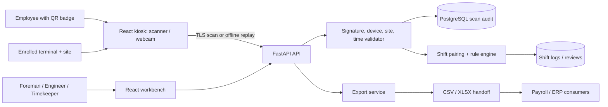

# System architecture and data flow

**Status:** target architecture from blueprint §1 plus explicitly proposed implementation boundaries.

## Context



## Required stack

- **Kiosk and review UI:** React 18, TypeScript, Tailwind CSS, browser scanner/camera support, Web Audio confirmation.
- **Service:** Python 3.12, FastAPI for token verification, geofence checks, rules, approvals and export.
- **Storage:** PostgreSQL 16 with pgcrypto, transactional append-only raw scan ledger and write-once raw punch values.
- **Handoff:** CSV/XLSX matching 06_QR_Timekeeper_Log exactly.

**Not defined by source:** hosting vendor, auth provider, queue broker, object storage, frontend bundler, Python package manager, ORM, migration tool, secrets service, SLOs. Select these in ADRs; do not represent them as installed dependencies.

## Domain boundaries

| Boundary | Owns | Must not do |
| --- | --- | --- |
| Kiosk UI | Hardware input, immediate feedback, durable offline outbox | Decide final payroll status; overwrite scan timestamps |
| Ingestion API | Authn of terminal, token/site/clock checks, idempotent event receipt, ledger append | Trust user-provided Emp_ID alone |
| Shift engine | Pair punches, determine Work_Date, compute hours/anomalies | Change original raw evidence |
| Workbench | Scoped review, approvals, override requests, KPIs | Write immutable raw fields |
| Export service | Exact columns, verified-only payable aggregate, audit holds, export receipt | Treat Pending or Disputed as payable |
| Database | Enforcement of immutability, constraints, foreign keys, event history | Permit role bypass via normal app credentials |
| Ops admin | Site/terminal config, key rotation, compliance controls | Change historical facts without audited versioning |

## Scan-to-export sequence

```mermaid
sequenceDiagram
  participant K as Kiosk
  participant A as API
  participant DB as PostgreSQL
  participant R as Rules
  participant W as Workbench
  participant E as Export
  K->>A: Scan(token, terminal, client_event_id)
  A->>DB: Append attempt + validation outcome
  alt Accepted & not debounced
    A->>DB: Fill permissible empty raw punch
    A->>R: Pair shift and calculate
    R->>DB: Save derived result / alert
  else Rejected / duplicate
    A->>DB: Keep audit record; no punch change
  end
  A-->>K: Recorded / Ignored / Rejected
  W->>A: Tiered approval or explained adjustment
  A->>DB: Append decision; update allowed derived/status fields
  E->>DB: Snapshot period including all statuses
  E-->>W: 23-column file + holds and receipt
```

## Trust and network boundaries

1. A QR token is **untrusted bearer material** until validated against key, time, active badge/employee and revocation state.
2. A terminal position/geofence establishes **terminal** location; do not assume employee geolocation or conclusive biometric identity.
3. Browser local storage is a **lower-trust** environment. Offline evidence requires device binding, encryption and replay reconciliation design.
4. All reviewer IDs and server timestamps derive from authentication/session and server time, never user-supplied values.
5. Sensitive gate images should be stored separately from export rows, with access logs and retention controls.
6. Payroll is downstream and must enforce status-based filtering even if the application displays derived totals.

## Transaction model (proposed)

- For an inbound event: verify terminal authentication → start transaction → insert append-only raw attempt idempotently → validate badge/site/time → lock active employee/shift pairing row → append accepted punch only if eligible → compute derived projection → commit. Rejected events are still audited.
- Use unique event UUID per device for delivery idempotence; do not conflate duplicate network delivery with legitimate duplicate tap.
- Store UTC instants and authoritative IANA site timezone. Work_Date is assigned per shift start in site-local time.
- Separate **raw facts** (immutable) from **projections** (recomputable) and **decisions** (append-only actor/event history).
- Configuration changes re-evaluate *active* exception queues without erasing previous classifications or changing finalized records silently.

## Operational failure modes

| Failure | Expected behavior |
| --- | --- |
| Invalid signature or inactive badge | Rejected audited scan, no punch mutation |
| Unregistered / out-of-geofence terminal | Rejected or quarantined event with reason |
| Offline kiosk | Explicit “Offline Captured & Sealed”, durable ordered queue, no final server acceptance claim |
| Device clock drifts | Quarantine or flag pending per approved policy, never silently rewrite captured times |
| Repeat submission after timeout | Same event receipt, no second punch |
| DB write failure | No success acknowledgment until persisted; retry idempotently |
| Pending verification at export | Display exact pending count; include row/status; place employee on hold |
| Partial export | Fail atomically, leave no “successful” receipt for incomplete file |

## Implementation notes

Proposed repositories/directories appear in [Development](../engineering/DEVELOPMENT.md). [Data model](DATA_MODEL.md) describes storage, [API](../api/API_CONTRACT.md) proposes wire contracts, and [Security](../engineering/SECURITY_PRIVACY.md) defines protective design requirements.
