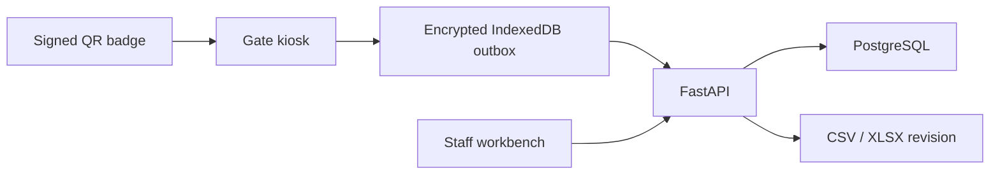

# System architecture

SiteGuard uses a React/TypeScript kiosk and workbench, FastAPI on Vercel or Uvicorn, and PostgreSQL 16+. Browser and API share an origin. Vercel's CDN serves the built web assets.

## Request boundaries

- Staff authenticate with a password or a configured OIDC issuer. Sessions use opaque HttpOnly cookies. The API enforces organization, site, and reviewer scope for domain requests.
- Terminals enroll with their own credentials and receive a bounded signed lease. The browser produces an ordered hash chain, signs events with its credential, and buffers them in encrypted IndexedDB. A service worker caches the app shell and assets.
- One PostgreSQL transaction handles each batch. An organization lock orders intake, reviews, policy changes, and payroll snapshots. Unique event IDs and terminal-generation sequences make replay safe. This locking favors consistency for the first release. Measure throughput before high-volume rollout.
- Accepted events reference a shift. Deferrable foreign keys and validation triggers link every raw punch to its immutable receipt. Reviewer state changes go through a database procedure that enforces stage, scope, version, reasons, and audit entries.
- Versioned export metadata and original file bytes are stored together. The API authenticates downloads and records them separately.
- Optional gate and badge images are encrypted in dedicated tables with time-bounded access and retention. Images are never included in the attendance exports.

See [PostgreSQL tables and invariants](DATA_MODEL.md), [API contracts](../api/API_CONTRACT.md), and [deployment setup](../engineering/VERCEL_DEPLOYMENT.md).
