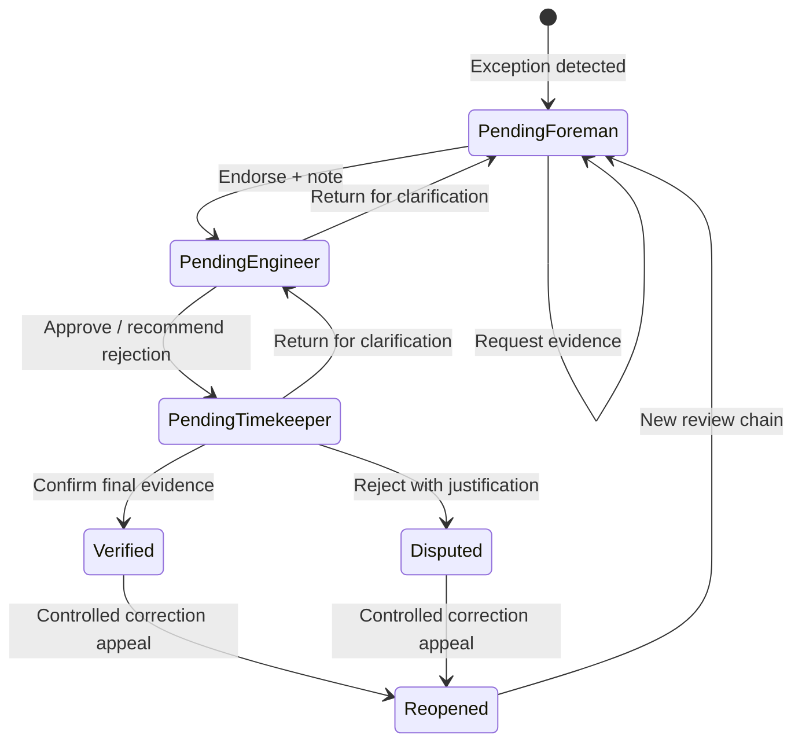

# Three-tier verification workflow and permission model

**Status:** tier order, states and mandatory justification from blueprint §4; specific endpoint names and transition routing are **proposed**.

## 1. Workflow tiers (source)

1. **Tier 1 — Site Foreman:** confirm physical mobilization, concrete-pour extension, weather standbys and local crew evidence.
2. **Tier 2 — Project Engineer / Department Head:** authorize or reject overtime and confirm project WBS/cost codes, especially `HIGH OT (>2h)`.
3. **Tier 3 — Central Timekeeper:** compare scan imagery against registered badge, apply non-destructive missed-punch corrections and make final `Verified` or `Disputed / Rejected` decision.

The blueprint uses three exported `Timekeeper_Status` values: **Pending Review**, **Verified**, **Disputed / Rejected**. Internal workflow stages are **not** additional export statuses.

## 2. Proposed internal stage machine

**Proposed mapping:** all active stages export `Pending Review`; final positive = `Verified`; final negative = `Disputed / Rejected`. Any reopen must create new audit events and an export revision instead of rewriting past handoffs.

Blueprint says clean OK scans may be bulk verified or auto-verified. **Open decision:** whether these bypass Tier 1/2, are self-attested by policy or require a separate delegation; defaults should be conservative.

## 3. Role access matrix (proposed starting point)

| Action | Employee | Kiosk terminal | Foreman | Engineer / Head | Timekeeper | Admin | Auditor |
| --- | --- | --- | --- | --- | --- | --- | --- |
| Submit scan | badge only | Yes (own terminal) | No | No | No | No | No |
| View own record | Proposed | No | Scoped crew | Scoped project | Scoped organization | Scoped org | Read-only assigned |
| View gate images | No | Capture only | Need-based | Need-based | Yes, justified | Restricted admin | Logged, restricted |
| Tier 1 endorsement | No | No | Yes, own crew | No | No | No | No |
| Tier 2 cost/OT disposition | No | No | No | Yes, own scope | No | No | No |
| Final Verified / Disputed | No | No | No | No | Yes | No by default | No |
| Set TK_Adjusted_In/Out | No | No | No | No | Yes | No by default | No |
| Configure site/keys/rules | No | No | No | No | No | Yes | No |
| Export pay-period file | No | No | No | No | Yes | Explicitly permitted | Read-only if authorized |
| Inspect audit trail | Own limited | No | Scoped | Scoped | Scoped | Scoped | Scoped, read-only |

Apply least privilege and tenant/site scoping at every API query. Admin should not silently impersonate a timekeeper; emergency elevation is a separate audited workflow.

## 4. Required verification metadata

Whenever `TK_Adjusted_In` or `TK_Adjusted_Out` has a value, or a row becomes `Disputed / Rejected`, reject save unless:

- `Verified_By_TK` is the authenticated timekeeper identity, not a client-supplied string.
- `TK_Verification_Notes` is non-empty after trimming and explains evidence/decision.
- `Verified_Timestamp` is assigned by the server and persisted. This field is internal and **not one of the 23 export columns**.

Keep both original and updated effective times; maintain before/after in append-only approval audit. A later correction must not erase prior notes, reviewer decisions or signed export history.

## 5. Approval and cost control

- Foreman attests field context; does not authorize overtime payout by itself.
- Engineer/department head verifies cost-code allocation and high OT. Valid codes in blueprint are examples: `PROJ-09` Structural; `DPWH-INFRA-04` Civil Works; `LGU-MAIN-01` Electrical.
- Central timekeeper examines side-by-side evidence, enters adjustments, and commits final status.
- Missing punches remain pending until explained and corrected or rejected. An override may cause primary anomaly to recompute to OK, but the original anomaly/override is retained historically.

## 6. Dashboard definitions and export impact

| KPI | Definition to implement |
| --- | --- |
| Total Scans | Define whether it counts **audit attempts** vs **shift rows**; source is ambiguous — select and label explicitly |
| Verified | Count final Verified shift records |
| Pending Review | Count current period records not final; drives audit holds |
| Disputed / Rejected | Count final rejected shift records |
| Missing QR Clock-Outs | Open effective-out records past configured closure |
| Verified Regular Hrs | Sum Calc_Reg_Hrs only for final Verified records not blocked by period release rules |
| Verified OT Hrs | Sum Calc_OT_Hrs only for final Verified records not blocked by period release rules |

The blueprint says all exported rows retain their status and downstream holds apply for **any** pending record for an employee. **Proposed separation:** dashboard aggregate “verified hours” can show all Verified rows while payroll release independently blocks an employee if the employee has any pending shift in that pay period. Do not conceal this distinction.

## 7. Approval abuse and consistency tests

- Foreman cannot finalize/payroll-export or adjust timestamps.
- Engineer cannot endorse another project or approve own unauthorized scope.
- Timekeeper cannot finalize missing mandatory upstream approvals unless explicitly delegated by policy.
- Notes must be non-empty for overrides/rejections; all review actions log actor and server time.
- A configuration change affecting hours marks active review stale; prior approval cannot be reused unnoticed.
- Double-submit same approval event remains idempotent; conflicting concurrent reviews return conflict.
- Every exported final state corresponds to an actual review trail or explicit auto-verification policy version.
